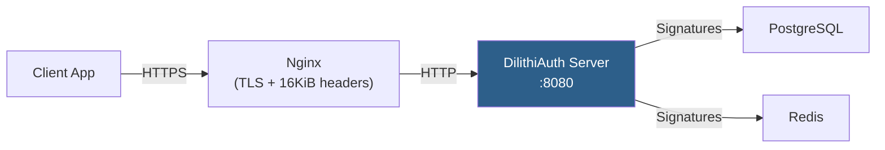
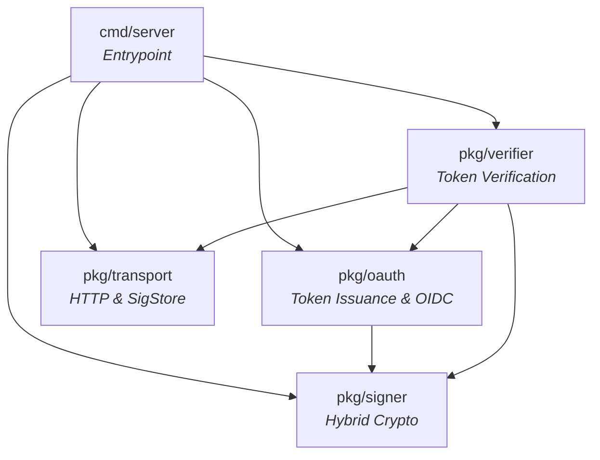
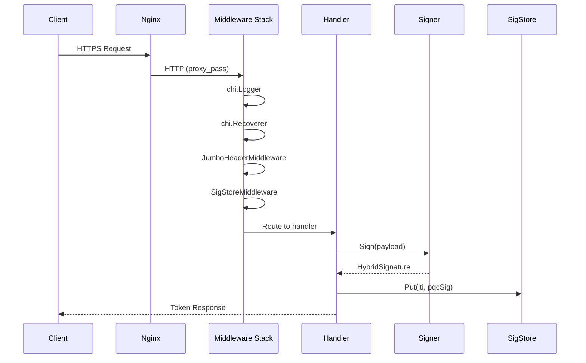

# System Architecture

DilithiAuth is a **post-quantum OAuth 2.0 identity provider** that dual-signs tokens with Ed25519 (classical) and ML-DSA-44 (NIST FIPS 204, quantum-safe). It mitigates **"Harvest Now, Decrypt Later" (HNDL)** attacks by ensuring that tokens remain cryptographically secure even against future quantum computers.

## High-Level Architecture

## Package Dependency Graph

## Package Overview

| Package | Path | Responsibility |
|---------|------|---------------|
| **server** | `cmd/server/` | Entrypoint. Wires key pairs, SigStore backend, OAuth provider, verifier, and chi router. |
| **signer** | `pkg/signer/` | Hybrid key pair (Ed25519 + ML-DSA-44) generation, signing, verification, serialization, and key rotation via `KeyManager`. |
| **oauth** | `pkg/oauth/` | OIDC Discovery/JWKS endpoints, three token issuance strategies (thin JWT, full JWT, CWT), and OAuth 2.0 authorization code flow. |
| **transport** | `pkg/transport/` | PQC-tuned HTTP server (16 KiB headers), jumbo-header middleware, `SigStoreBackend` interface with memory, file, PostgreSQL, and Redis implementations, and context helpers. |
| **verifier** | `pkg/verifier/` | Token verification for all three formats (thin JWT, full JWT, CWT) with auto-detection, plus HTTP middleware that injects `VerifiedClaims` into request context. |

## Request Flow

## Key Design Decisions

1. **Shared Key ID (`kid`)** — Both Ed25519 and ML-DSA-44 keys share a single `kid` in JWKS. Simplifies key lookup and rotation.

2. **Dual Signing** — Every token is signed by both algorithms. The Ed25519 signature provides backward compatibility; the ML-DSA-44 signature provides quantum safety.

3. **Pluggable SigStore Backends** — The `SigStoreBackend` interface allows swapping storage without changing token issuance or verification logic. Four backends ship out of the box.

4. **Context Injection** — `SigStore` and `VerifiedClaims` are injected into the request context via middleware, keeping handlers decoupled from infrastructure.

5. **Three Token Strategies** — Thin (small, sidecar), Full (self-contained, large), and CWT (binary, smallest) let operators choose the right trade-off for their deployment.

## Dependencies

| Dependency | Version | Purpose |
|-----------|---------|---------|
| `cloudflare/circl` | v1.6.3 | ML-DSA-44 (FIPS 204) post-quantum signatures |
| `fxamacker/cbor/v2` | v2.9.0 | CBOR encoding for CWT tokens |
| `go-chi/chi/v5` | v5.2.5 | HTTP routing |
| `golang-jwt/jwt/v5` | v5.3.1 | JWT signing and parsing |
| `lib/pq` | v1.11.2 | PostgreSQL driver |
| `redis/go-redis/v9` | v9.18.0 | Redis client |
