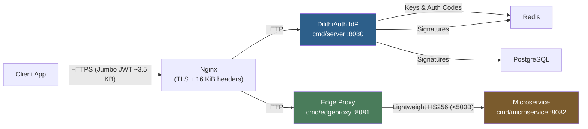
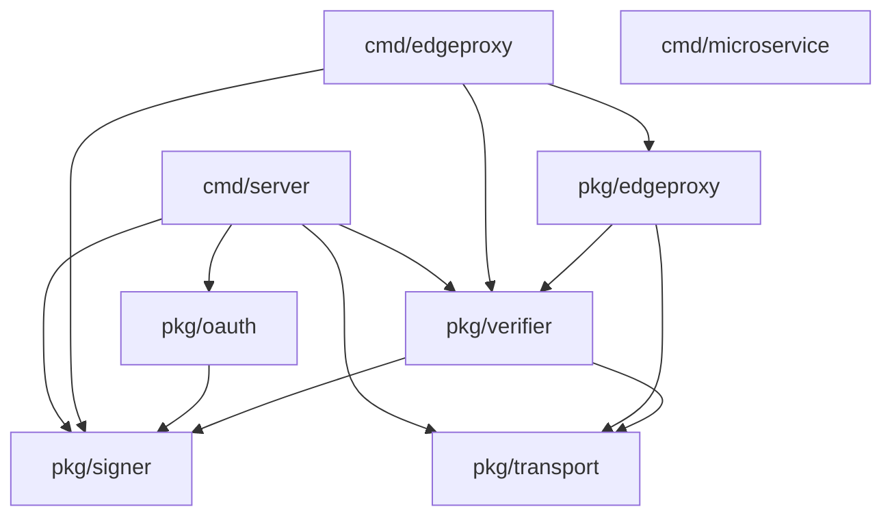
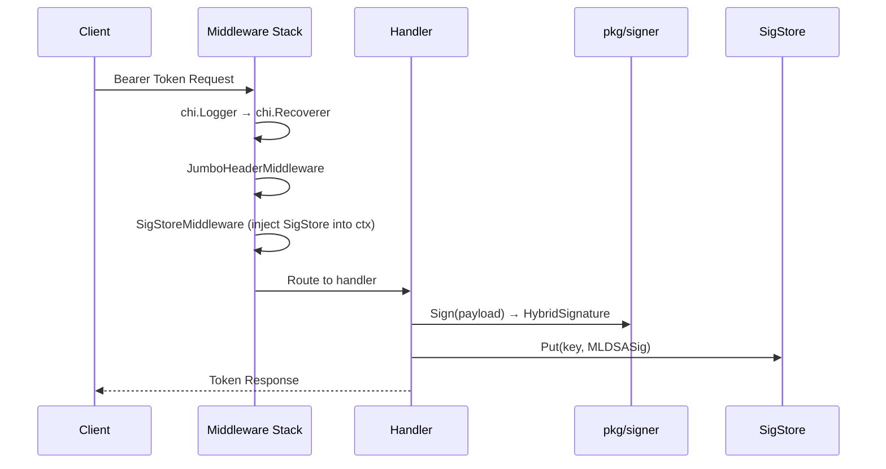

# System Architecture

DilithiAuth is a **post-quantum OAuth 2.0 identity provider** that dual-signs tokens with Ed25519 (classical) and ML-DSA-44 (NIST FIPS 204, quantum-safe). It mitigates **"Harvest Now, Decrypt Later" (HNDL)** attacks by ensuring tokens remain cryptographically secure against future quantum computers.

---

## Table of Contents

1. [Directory Structure](#directory-structure)
2. [High-Level Architecture](#high-level-architecture)
3. [Package Overview](#package-overview)
4. [HTTP Endpoints](#http-endpoints)
5. [Token Strategies & Data Flow](#token-strategies--data-flow)
6. [Key Management](#key-management)
7. [Signature Sidecar (SigStore)](#signature-sidecar-sigstore)
8. [Authorization Code Flow](#authorization-code-flow)
9. [Edge Proxy: PQC Offloading](#edge-proxy-pqc-offloading)
10. [Deployment Patterns](#deployment-patterns)
11. [Configuration](#configuration)
12. [Token Size Comparison](#token-size-comparison)
13. [Dependencies](#dependencies)
14. [Security Considerations](#security-considerations)

---

## Directory Structure

```
DilithiAuth/
├── cmd/
│   ├── server/          # Identity Provider (IdP) — main binary
│   ├── edgeproxy/       # PQC-verifying reverse proxy gateway
│   └── microservice/    # Demo internal microservice (HS256, PQC-agnostic)
├── pkg/
│   ├── signer/          # Hybrid key pair generation, signing, rotation
│   ├── oauth/           # Token issuance (thin JWT, full JWT, CWT) + OIDC
│   ├── transport/       # PQC HTTP server, SigStore backends, middleware
│   ├── verifier/        # Token verification for all three formats
│   └── edgeproxy/       # Edge proxy logic and strip middleware
├── deployments/         # Nginx config templates (16 KiB header support)
├── docs/                # Supplementary documentation
├── go.mod / go.sum
└── README.md
```

---

## High-Level Architecture



### Package Dependency Graph



---

## Package Overview

| Package | Path | Responsibility |
|---------|------|---------------|
| **server** | `cmd/server/` | Entrypoint. Configures key pair, SigStore backend, OAuth provider, verifier, and chi router. |
| **edgeproxy** | `cmd/edgeproxy/` | Reverse proxy: verifies PQC tokens, strips ML-DSA-44 signature, forwards lightweight HS256 to upstream. |
| **microservice** | `cmd/microservice/` | Demo internal service. Validates incoming HS256 tokens; completely PQC-agnostic. |
| **signer** | `pkg/signer/` | Hybrid key pair (Ed25519 + ML-DSA-44) generation, signing, verification, JWKS export, and `KeyManager` with rotation. |
| **oauth** | `pkg/oauth/` | OIDC discovery/JWKS endpoints, three token issuance strategies (thin JWT, full JWT, CWT), and OAuth 2.0 authorization code flow. |
| **transport** | `pkg/transport/` | PQC-tuned HTTP server (16 KiB `MaxHeaderBytes`), jumbo-header middleware, `SigStoreBackend` interface with Memory, File, PostgreSQL, and Redis implementations. |
| **verifier** | `pkg/verifier/` | Token verification for all three formats with auto-detection, plus HTTP middleware injecting `VerifiedClaims` into context. |
| **edgeproxy (pkg)** | `pkg/edgeproxy/` | Core proxy handler and `StripPQCMiddleware` for embedding in existing routers. |

---

## HTTP Endpoints

### Identity Provider (`cmd/server`, default `:8080`)

| Endpoint | Method | Auth | Description |
|----------|--------|------|-------------|
| `/.well-known/openid-configuration` | GET | None | OIDC discovery document |
| `/.well-known/jwks.json` | GET | None | Public JWKS (Ed25519 + ML-DSA-44) |
| `/token/thin` | POST/GET | None | Issue **thin JWT** (Ed25519 only, PQC sig in SigStore) |
| `/token/full` | POST/GET | None | Issue **full/jumbo JWT** (both sigs embedded) |
| `/token/cwt` | POST/GET | None | Issue **CWT** (CBOR, thin-token pattern) |
| `/authorize` | GET | None | OAuth 2.0 login form |
| `/authorize` | POST | None | Authenticate user, issue auth code, redirect |
| `/token` | POST | None | Exchange auth code for thin JWT |
| `/admin/rotate` | POST | None* | Rotate active signing key |
| `/protected/whoami` | GET | Bearer JWT | Demo protected endpoint |
| `/healthz` | GET | None | Health check — returns `"ok"` |

> *`/admin/rotate` is currently unguarded — see [Security Considerations](#security-considerations).

### Edge Proxy (`cmd/edgeproxy`, default `:8081`)

| Endpoint | Method | Description |
|----------|--------|-------------|
| `/*` (all routes) | All | Verify incoming PQC token, strip ML-DSA-44 sig, proxy to upstream with HS256 |

### Internal Microservice (`cmd/microservice`, default `:8082`)

| Endpoint | Method | Auth | Description |
|----------|--------|------|-------------|
| `/api/data` | GET | HS256 Bearer | Demo protected resource (receives classical token from Edge Proxy) |

---

## Token Strategies & Data Flow

DilithiAuth supports three token formats. Each trades token size against self-containment and infrastructure requirements.

### 1. Thin JWT

The ML-DSA-44 signature is stored out-of-band in a SigStore. The token carries only a SHA-256 reference (`pqc_ref`).

```
Issue (IssueJWTThin)
  ├─ Generate JTI (16 random bytes, base64url)
  ├─ Build RegisteredClaims {iss, sub, iat, exp, jti}
  ├─ Dual-sign with HybridKeyPair
  │   ├─ Ed25519 sig  (64 bytes)
  │   └─ ML-DSA-44 sig (~2420 bytes)
  ├─ pqc_ref = base64url(SHA-256(MLDSASig))
  ├─ Build HybridClaims {RegisteredClaims + pqc_ref}
  ├─ Sign JWT with Ed25519 (jwt-go)
  └─ SigStore.Put(pqc_ref, MLDSASig)

Response: { access_token, token_type, pqc_ref }

Verify (VerifyJWTThin)
  ├─ Parse + verify Ed25519 signature
  ├─ Extract pqc_ref from claims
  ├─ MLDSASig = SigStore.Get(pqc_ref)
  ├─ Assert SHA-256(MLDSASig) == pqc_ref
  ├─ payload = json.Marshal(RegisteredClaims)
  └─ Verify ML-DSA-44 over payload
```

**Token size:** ~400–500 bytes | **Sidecar:** required

---

### 2. Full / Jumbo JWT

The ML-DSA-44 signature is embedded directly in the `pqc_sig` claim. Self-contained but large.

```
Issue (IssueJWTFull)
  ├─ Generate JTI
  ├─ Dual-sign payload
  ├─ pqc_sig = base64url(MLDSASig)
  ├─ Build HybridClaims {RegisteredClaims + pqc_sig}
  └─ Sign JWT with Ed25519

Response: { access_token, token_type }

Verify (VerifyJWTFull)
  ├─ Parse + verify Ed25519 signature
  ├─ Decode pqc_sig (base64url → binary)
  ├─ payload = json.Marshal(RegisteredClaims)
  └─ Verify ML-DSA-44 over payload
```

**Token size:** ~3–4 KB | **Sidecar:** not required | **Headers:** require 16 KiB limit

---

### 3. CWT (CBOR Web Token)

RFC 8392 binary encoding. Uses integer claim keys and thin-token approach. Smallest format.

```
Issue (IssueCWT)
  ├─ Generate JTI
  ├─ Build CWTClaims {iss=1, sub=2, exp=4, iat=6, cti=7}
  ├─ Marshal base claims to CBOR → claimsBytes
  ├─ Dual-sign claimsBytes
  ├─ pqc_ref = base64url(SHA-256(MLDSASig))
  ├─ Set pqc_ref (claim 8) in CWTClaims
  ├─ Build CBOR envelope = [claimsBytes, Ed25519Sig]
  └─ SigStore.Put(jti, MLDSASig)

Response: CBOR bytes (Content-Type: application/cbor)
Headers:  X-Token-Id: <jti>  X-PQC-Ref: <pqc_ref>

Verify (VerifyCWT)
  ├─ Unmarshal CBOR envelope → [claimsBytes, edSig]
  ├─ Unmarshal claimsBytes → CWTClaims
  ├─ baseClaims = CWTClaims without pqc_ref
  ├─ baseBytes = CBOR(baseClaims)
  ├─ Verify Ed25519 over baseBytes
  ├─ Check exp
  ├─ MLDSASig = SigStore.Get(jti)
  ├─ Assert SHA-256(MLDSASig) == pqc_ref
  └─ Verify ML-DSA-44 over baseBytes
```

**Token size:** ~1.2–1.5 KB | **Sidecar:** required | **Note:** binary transport

---

### Middleware Request Flow



---

## Key Management

### Key Types

```go
// pkg/signer
type HybridKeyPair struct {
    Kid           string
    Ed25519Public  ed25519.PublicKey
    Ed25519Private ed25519.PrivateKey
    MLDSAPublic   *mldsa44.PublicKey
    MLDSAPrivate  *mldsa44.PrivateKey
}

type HybridSignature struct {
    Ed25519Sig []byte  // 64 bytes
    MLDSASig   []byte  // ~2420 bytes
}
```

Both keys share a single `kid`. JWKS advertises both `x` (Ed25519) and `mldsa44_pub` (ML-DSA-44) fields per key entry.

### KeyManager

`KeyManager` handles multiple key pairs with lazy loading and optional rotation:

- `ActiveKey()` — returns the current signing key
- `KeyByKid(kid)` — retrieves a specific key (with lazy-load from store)
- `Rotate()` — generates a new key, persists it, makes it active
- Periodic refresh (every 10 s) detects external rotations from the store

### KeyStore Backends

| Backend | Type | Use Case |
|---------|------|----------|
| `FileKeyStore` | File system | Single-node persistent keys; JSON files + `active_kid.txt` |
| `RedisKeyStore` | Redis | Distributed multi-instance deployments |
| *(ephemeral)* | In-memory | Dev/demo; keys lost on restart |

**Key rotation endpoint:** `POST /admin/rotate` returns `{ kid, status: "rotated" }`.

---

## Signature Sidecar (SigStore)

The SigStore decouples ML-DSA-44 signature storage from the token, enabling the thin-token pattern.

### Interface

```go
// pkg/transport
type SigStoreBackend interface {
    Put(jti string, sig []byte)
    Get(jti string) ([]byte, bool)
    Delete(jti string)
    Len() int
}
```

### Backends

| Backend | Key | Use Case | Notes |
|---------|-----|----------|-------|
| `MemorySigStore` | `DILITHIAUTH_SIGSTORE=memory` | Dev/demo | Unbounded growth; not production-safe |
| `FileSigStore` | `DILITHIAUTH_SIGSTORE=file` | Single-node | Atomic writes (temp + rename); JSON file |
| `PostgresSigStore` | `DILITHIAUTH_SIGSTORE=postgres` | Production | `sig_store(jti, sig, created_at)` table; auto-created |
| `RedisSigStore` | `DILITHIAUTH_SIGSTORE=redis` | Distributed | Configurable prefix (`sigstore:`) and TTL |

The SigStore is injected into every request via `SigStoreMiddleware`. Handlers access it through `transport.SigStoreFromContext(ctx)`.

---

## Authorization Code Flow

DilithiAuth implements RFC 6749 Authorization Code flow with post-quantum token issuance.

```
1. GET /authorize?client_id=...&redirect_uri=...&state=...
   → IdP returns HTML login form

2. POST /authorize
   Body: username=alice&password=...&client_id=...&redirect_uri=...
   → IdP authenticates user, stores AuthCode, redirects:
   Location: <redirect_uri>?code=<32-byte base64url>&state=...

3. POST /token
   Body: grant_type=authorization_code&code=...&client_id=...&redirect_uri=...
   → IdP redeems code (single-use), issues thin JWT:
   { access_token, token_type, pqc_ref }
```

### AuthzStore Backends

| Backend | Type | Notes |
|---------|------|-------|
| `MemoryAuthzStore` | In-memory | Demo only; plaintext passwords |
| `RedisAuthzStore` | Redis | Single-use guarantee via Redis transactions; configurable TTL |

### Key Types

```go
type AuthCode struct {
    Code, Subject, ClientID, RedirectURI, Scope string
    ExpiresAt time.Time
    Used      bool
}

type DemoUser  struct { Username, Password, Subject string }
type DemoClient struct { ClientID, RedirectURI, Name string }
```

---

## Edge Proxy: PQC Offloading

The Edge Proxy allows internal microservices to remain completely PQC-agnostic.

### Flow

```
Client
  │  Jumbo JWT (~3.5 KB, Authorization: Bearer eyJ...)
  ▼
cmd/edgeproxy (:8081)
  ├─ Extract Bearer token
  ├─ verifier.VerifyJWT()
  │   ├─ Detect full JWT (has pqc_sig)
  │   ├─ Verify Ed25519 signature
  │   └─ Verify ML-DSA-44 signature
  ├─ Extract VerifiedClaims {sub, iss, exp, ...}
  ├─ Build new RegisteredClaims
  ├─ Sign with HS256 (internalSecret)
  ├─ Set Authorization: Bearer <HS256 token>
  ├─ Set X-User-Subject: <subject>
  └─ Reverse proxy to upstream

cmd/microservice (:8082)
  ├─ Receives HS256 token (<500 bytes, standard headers)
  ├─ Validates symmetrically
  └─ Returns response
```

### Middleware Alternative

`pkg/edgeproxy.StripPQCMiddleware(next)` can be embedded in an existing Go chi router instead of running a standalone proxy process.

---

## Deployment Patterns

### Pattern 1: Stateless Edge Proxy (Recommended)

Best for production. Internal services require no PQC awareness or SigStore access.

```
Client
  │ Jumbo JWT (16 KiB headers)
  ▼
Load Balancer
  ▼
Edge Proxy Cluster ──── Redis (shared KeyStore)
  │ HS256 (<500 B, standard headers)
  ▼
Microservice Cluster (stateless, PQC-agnostic)
```

### Pattern 2: Distributed IdP + Thin Tokens

Thin tokens keep header sizes small. Internal services must be PQC-aware and can access the SigStore.

```
Client
  │ Thin JWT (<500 B) + pqc_ref
  ▼
DilithiAuth IdP Cluster ──── Redis (KeyStore + AuthzStore + SigStore)
  │ Thin JWT
  ▼
Internal Services ──── SigStore.Get(pqc_ref) → verify ML-DSA-44
```

### Pattern 3: Ephemeral Single-Node (Demo)

Suitable for local development and CI. No persistence; fresh key pair on every start.

```
DilithiAuth IdP (single process)
  ├─ MemorySigStore
  ├─ MemoryAuthzStore
  └─ Ephemeral HybridKeyPair (lost on restart)
```

---

## Configuration

All configuration is via environment variables.

### Identity Provider

| Variable | Default | Description |
|----------|---------|-------------|
| `DILITHIAUTH_ISSUER` | `https://auth.dilithiauth.io` | Base URL advertised in OIDC discovery and token `iss` claim |
| `DILITHIAUTH_ADDR` | `:8080` | IdP listen address |
| `DILITHIAUTH_KEYSTORE` | `file` | Key persistence backend: `file` or `redis` |
| `DILITHIAUTH_KEYS_DIR` | `""` (ephemeral) | Directory for file-backed key storage |
| `DILITHIAUTH_REDIS_ADDR` | `localhost:6379` | Redis address for key/auth stores |
| `DILITHIAUTH_SIGSTORE` | `memory` | SigStore backend: `memory`, `file`, `postgres`, `redis` |
| `DILITHIAUTH_SIGSTORE_PATH` | `./data/sigstore.json` | Path for file-backed SigStore |
| `DILITHIAUTH_POSTGRES_DSN` | `postgres://localhost:5432/dilithiauth?sslmode=disable` | PostgreSQL DSN for postgres-backed SigStore |
| `DILITHIAUTH_AUTHZSTORE` | `memory` | Authorization code store: `memory` or `redis` |

### Edge Proxy

| Variable | Default | Description |
|----------|---------|-------------|
| `EDGE_PROXY_ADDR` | `:8081` | Edge proxy listen address |
| `UPSTREAM_URL` | `http://localhost:8082` | Upstream microservice URL |
| `INTERNAL_JWT_SECRET` | `super-secret-key-for-internal-services` | Symmetric secret for HS256 internal tokens |

### Microservice

| Variable | Default | Description |
|----------|---------|-------------|
| `MICROSERVICE_ADDR` | `:8082` | Microservice listen address |

---

## Token Size Comparison

| Format | Signature Storage | Approx. Size | Sidecar Needed | Infrastructure |
|--------|------------------|-------------|----------------|---------------|
| Classical JWT (EdDSA only) | Embedded | ~300–400 B | No | Standard (4–8 KB headers) |
| **Thin JWT** | SigStore (external) | ~400–500 B | **Yes** | Standard |
| **Full/Jumbo JWT** | Embedded (`pqc_sig`) | ~3–4 KB | No | **16 KiB headers required** |
| **CWT** (thin) | SigStore (external) | ~1.2–1.5 KB | **Yes** | Standard |
| Internal HS256 (post-strip) | Embedded | ~300–400 B | No | Standard |

---

## Dependencies

| Dependency | Version | Purpose |
|-----------|---------|---------|
| `cloudflare/circl` | v1.6.3 | ML-DSA-44 (NIST FIPS 204) — only production-ready Go implementation |
| `fxamacker/cbor/v2` | v2.9.0 | CBOR encoding for RFC 8392 CWT tokens |
| `go-chi/chi/v5` | v5.2.5 | Lightweight HTTP routing with clean middleware chaining |
| `golang-jwt/jwt/v5` | v5.3.1 | JWT signing and parsing |
| `lib/pq` | v1.11.2 | PostgreSQL driver (postgres SigStore backend) |
| `redis/go-redis/v9` | v9.18.0 | Redis client (distributed KeyStore, AuthzStore, SigStore) |

---

## Security Considerations

### Known Gaps (Current Implementation)

| Issue | Location | Severity | Notes |
|-------|----------|----------|-------|
| Plaintext passwords | `MemoryAuthzStore` | High | `DemoUser.Password` stored and compared as plain text |
| Unguarded admin endpoint | `POST /admin/rotate` | High | No authentication required to rotate keys |
| Unbounded memory growth | `MemorySigStore` | Medium | Signatures never evicted; potential DoS |
| Swallowed backend errors | `SigStoreBackend.Put/Delete` | Medium | Returns void; errors silently discarded |
| No PKCE support | Auth code flow | Medium | Authorization code interception is possible |
| No token revocation | All token types | Medium | Issued tokens cannot be invalidated before expiry |

### Mitigations in Place

- Every token requires **both** signatures to be valid (defense in depth).
- Redis-backed `AuthzStore` uses transactions to ensure **single-use auth codes**.
- `pqc_ref` is a SHA-256 hash binding the thin token to its sidecar signature — tampering is detected.
- `MaxHeaderBytes = 16 KiB` is set only on the IdP/Edge Proxy; internal services retain standard limits.
- Shared `kid` for both keys simplifies rotation — rotating one rotates both atomically.
