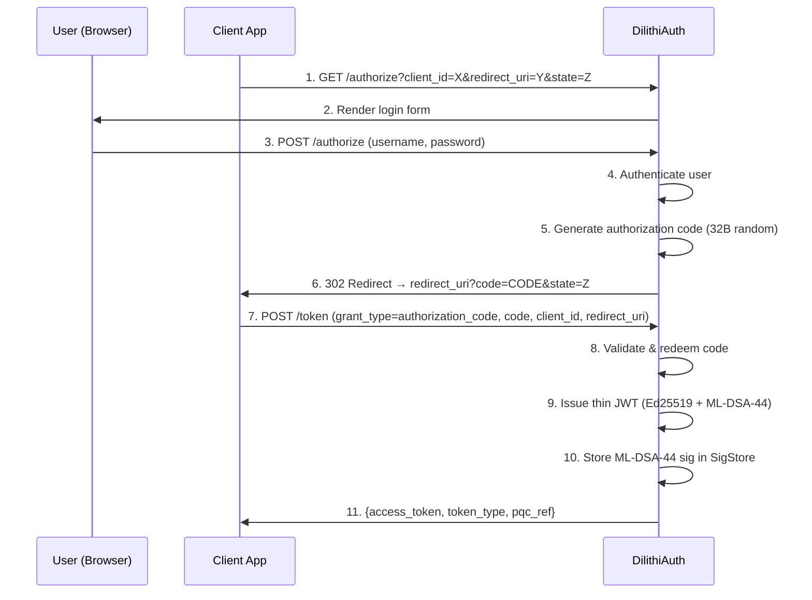
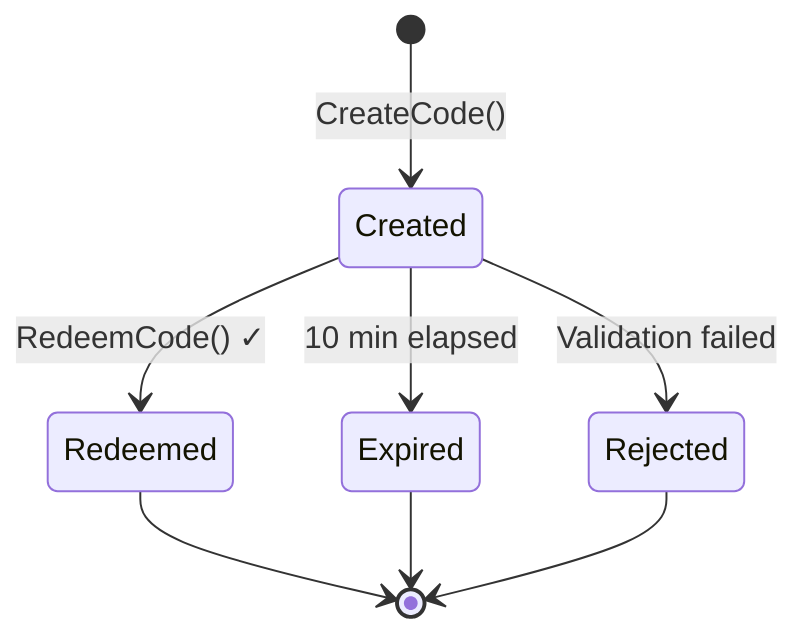

# OAuth 2.0 Authorization Code Flow

DilithiAuth implements the standard OAuth 2.0 Authorization Code flow (RFC 6749) with post-quantum token issuance. After authentication, it issues a thin JWT dual-signed with Ed25519 and ML-DSA-44.

## Flow Overview



## Authorization Code Lifecycle



## Endpoints

### GET /authorize

Renders the login form. Required query parameters:

| Parameter | Required | Description |
|-----------|----------|-------------|
| `client_id` | Yes | Registered client identifier |
| `redirect_uri` | Yes | Must match the client's registered redirect URI |
| `state` | No | Opaque value passed back to the client |
| `scope` | No | Requested scope |

The server validates `client_id` and `redirect_uri` match a registered client before rendering the form.

### POST /authorize

Processes the login form submission. Form fields:

| Field | Description |
|-------|-------------|
| `username` | User's username |
| `password` | User's password |
| `client_id` | From the hidden form field |
| `redirect_uri` | From the hidden form field |
| `state` | From the hidden form field |
| `scope` | From the hidden form field |

On success, redirects to `redirect_uri?code=<CODE>&state=<STATE>`.

### POST /token

Exchanges an authorization code for an access token.

**Request (form-encoded):**
```
grant_type=authorization_code
code=<authorization_code>
client_id=<client_id>
redirect_uri=<redirect_uri>
```

**Response:**
```json
{
  "access_token": "eyJhbGciOiJFZERTQSIs...",
  "token_type": "Bearer",
  "pqc_ref": "abc123..."
}
```

## Demo Users and Clients

The server ships with pre-configured demo credentials:

**Users:**
| Username | Password | Subject |
|----------|----------|---------|
| `alice` | `password` | `alice` |
| `bob` | `password` | `bob` |

**Clients:**
| Client ID | Redirect URI | Name |
|-----------|-------------|------|
| `demo-client` | `http://localhost:8080/callback` | Demo Client |

## Authorization Code Details

- **Generation:** 32 random bytes, base64url-encoded
- **Expiry:** 10 minutes from creation
- **Single-use:** Marked as `Used` on redemption — cannot be reused
- **Storage:** In-memory `AuthzStore` (not persisted across restarts)

**Source:** `pkg/oauth/authz.go`

## Security Considerations

| Check | Description |
|-------|-------------|
| Code expiry | Codes expire after 10 minutes |
| Single-use | Each code can only be redeemed once |
| Client ID match | Code's `client_id` must match the requesting client |
| Redirect URI match | Code's `redirect_uri` must match the request |
| Client validation | `client_id` and `redirect_uri` are validated against registered clients |

## Example: Full Flow

```bash
# 1. Start the authorization flow
open "http://localhost:8080/authorize?client_id=demo-client&redirect_uri=http://localhost:8080/callback&state=xyz"

# 2. User logs in with alice/password → redirected to callback with code

# 3. Exchange code for token
curl -X POST http://localhost:8080/token \
  -d "grant_type=authorization_code" \
  -d "code=<CODE_FROM_REDIRECT>" \
  -d "client_id=demo-client" \
  -d "redirect_uri=http://localhost:8080/callback"

# Response:
# {"access_token":"eyJ...","token_type":"Bearer","pqc_ref":"..."}
```

**Source:** `pkg/oauth/authz_handlers.go`
