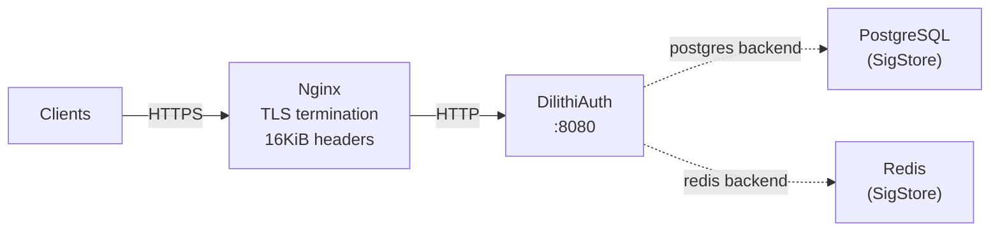

# Deployment & Configuration

## Environment Variables

| Variable | Default | Description |
|----------|---------|-------------|
| `DILITHIAUTH_ISSUER` | `https://auth.dilithiauth.io` | Base URL of the issuer (appears in tokens and OIDC discovery) |
| `DILITHIAUTH_ADDR` | `:8080` | Listen address |
| `DILITHIAUTH_SIGSTORE` | `memory` | SigStore backend: `memory`, `file`, `postgres`, or `redis` |
| `DILITHIAUTH_SIGSTORE_PATH` | `./data/sigstore.json` | File path for file-backed SigStore |
| `DILITHIAUTH_POSTGRES_DSN` | `postgres://localhost:5432/dilithiauth?sslmode=disable` | PostgreSQL connection string |
| `DILITHIAUTH_REDIS_ADDR` | `localhost:6379` | Redis address (host:port) |
| `DILITHIAUTH_KEYS_DIR` | *(empty)* | Directory for persistent key storage. Empty = ephemeral keys. |

## Deployment Topology



## Server Settings

The Go HTTP server is configured for PQC token handling:

| Setting | Value | Purpose |
|---------|-------|---------|
| `MaxHeaderBytes` | 16,384 (16 KiB) | Accommodate full/jumbo JWTs (~3-4 KB) |
| `ReadTimeout` | 15 seconds | Prevent slow client attacks |
| `WriteTimeout` | 15 seconds | Prevent stuck connections |
| `IdleTimeout` | 60 seconds | Keep-alive timeout |

## Nginx Configuration

PQC tokens in the `Authorization` header can reach 3.5-4 KB, exceeding Nginx's default 4 KB limit. Apply these settings:

```nginx
http {
    # Single header line up to 8 KiB
    client_header_buffer_size 8k;

    # Up to 4 x 16 KiB for complete header section
    large_client_header_buffers 4 16k;

    upstream dilithiauth {
        server 127.0.0.1:8080;
        keepalive 16;
    }

    server {
        listen 443 ssl;
        server_name auth.dilithiauth.io;

        ssl_certificate     /etc/ssl/certs/dilithiauth.crt;
        ssl_certificate_key /etc/ssl/private/dilithiauth.key;

        location / {
            proxy_pass         http://dilithiauth;
            proxy_http_version 1.1;
            proxy_set_header   Connection "";
            proxy_set_header   Host $host;
            proxy_set_header   X-Real-IP $remote_addr;
            proxy_pass_request_headers on;

            # Handle large JWKS responses (ML-DSA-44 public keys)
            proxy_buffer_size  16k;
            proxy_buffers      4 16k;
        }
    }
}
```

**Source:** `deployments/nginx.conf`

## API Endpoints

| Method | Path | Description |
|--------|------|-------------|
| `GET` | `/.well-known/openid-configuration` | OIDC Discovery document |
| `GET` | `/.well-known/jwks.json` | JSON Web Key Set (Ed25519 + ML-DSA-44 public keys) |
| `POST` | `/token/thin` | Issue thin JWT (sidecar PQC signature) |
| `POST` | `/token/full` | Issue full/jumbo JWT (embedded PQC signature) |
| `POST` | `/token/cwt` | Issue CBOR Web Token |
| `GET` | `/authorize` | OAuth 2.0 authorization endpoint (login form) |
| `POST` | `/authorize` | Process login and redirect with authorization code |
| `POST` | `/token` | OAuth 2.0 token exchange (authorization_code grant) |
| `POST` | `/admin/rotate` | Rotate signing keys (requires `DILITHIAUTH_KEYS_DIR`) |
| `GET` | `/protected/whoami` | Protected endpoint — returns verified claims |
| `GET` | `/healthz` | Health check (returns `ok`) |

## Quick Start

### Minimal (in-memory, ephemeral keys)

```bash
go run ./cmd/server
```

### With persistent keys

```bash
DILITHIAUTH_KEYS_DIR=./keys go run ./cmd/server
```

### With PostgreSQL backend

```bash
# Create the database
createdb dilithiauth

# Start server
DILITHIAUTH_SIGSTORE=postgres \
DILITHIAUTH_POSTGRES_DSN="postgres://localhost:5432/dilithiauth?sslmode=disable" \
DILITHIAUTH_KEYS_DIR=./keys \
  go run ./cmd/server
```

### With Redis backend

```bash
DILITHIAUTH_SIGSTORE=redis \
DILITHIAUTH_REDIS_ADDR=localhost:6379 \
DILITHIAUTH_KEYS_DIR=./keys \
  go run ./cmd/server
```

## Testing the Deployment

```bash
# Health check
curl http://localhost:8080/healthz

# OIDC Discovery
curl http://localhost:8080/.well-known/openid-configuration | jq

# JWKS
curl http://localhost:8080/.well-known/jwks.json | jq

# Issue a thin token
curl -X POST "http://localhost:8080/token/thin?sub=alice" | jq

# Issue a full token
curl -X POST "http://localhost:8080/token/full?sub=alice" | jq

# Use a token on a protected endpoint
TOKEN=$(curl -s -X POST "http://localhost:8080/token/thin?sub=alice" | jq -r .access_token)
curl -H "Authorization: Bearer $TOKEN" http://localhost:8080/protected/whoami | jq

# Verify signatures in PostgreSQL
psql dilithiauth -c "SELECT jti, length(sig) FROM sig_store;"
```

## Middleware Stack

Requests pass through this middleware chain in order:

1. **chi.Logger** — Request/response logging
2. **chi.Recoverer** — Panic recovery
3. **JumboHeaderMiddleware** — Documents large header intent (hook for future metrics)
4. **SigStoreMiddleware** — Injects `SigStore` into request context

Protected routes additionally use:

5. **Verifier.Middleware()** — Extracts Bearer token, verifies, injects `VerifiedClaims`

## Build

```bash
# Build the server binary
go build ./cmd/server

# Run all tests
go test ./...

# Run a specific test
go test ./pkg/oauth -run TestIssueJWTThin
```
