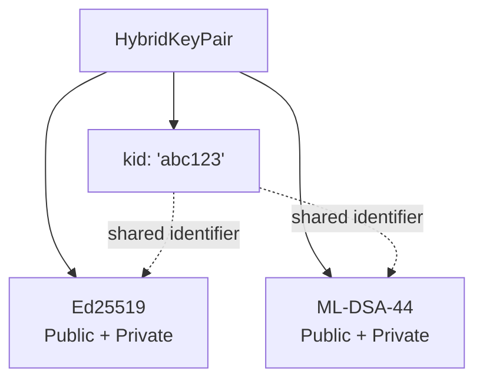
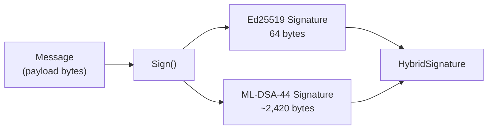
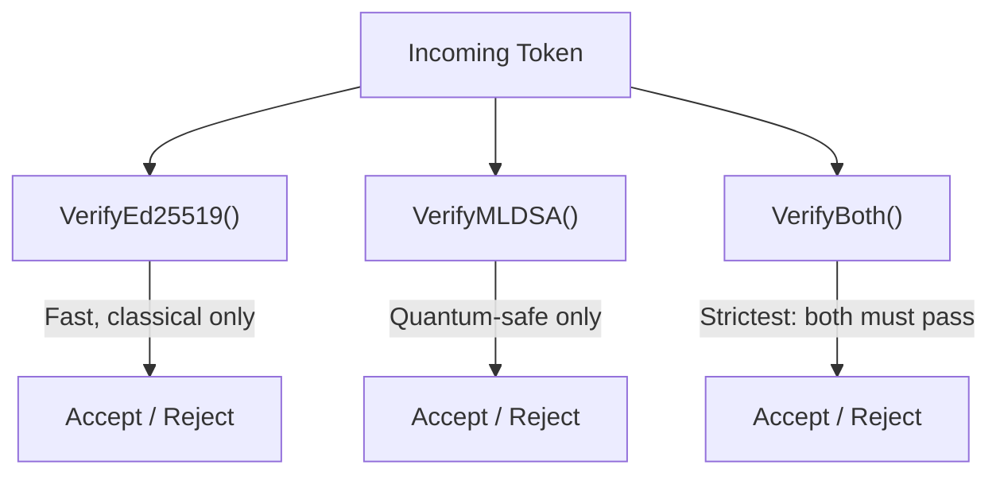

# Hybrid Signing

DilithiAuth uses a **hybrid signing** approach that combines a classical algorithm (Ed25519) with a post-quantum algorithm (ML-DSA-44, NIST FIPS 204). Every token is dual-signed, providing both backward compatibility and quantum safety.

## Why Hybrid?

| | Ed25519 (Classical) | ML-DSA-44 (Post-Quantum) |
|---|---|---|
| **Standard** | RFC 8032 | NIST FIPS 204 |
| **Signature Size** | 64 bytes | ~2,420 bytes |
| **Public Key Size** | 32 bytes | 1,312 bytes |
| **Speed** | Very fast | Fast |
| **Quantum Safe** | No | Yes |

A pure post-quantum deployment risks interoperability issues with existing infrastructure. A pure classical deployment is vulnerable to **"Harvest Now, Decrypt Later"** — an adversary records today's tokens and breaks them later with a quantum computer.

Hybrid signing gives both: classical verification for today's infrastructure, quantum-safe verification for long-term security.

## HybridKeyPair Structure



Both key types share a single `kid` (Key ID), generated as 8 random bytes base64url-encoded. This `kid` appears in JWT headers and JWKS entries.

**Source:** `pkg/signer/signer.go`

```go
type HybridKeyPair struct {
    Kid            string
    Ed25519Public  ed25519.PublicKey
    Ed25519Private ed25519.PrivateKey
    MLDSAPublic    *mldsa44.PublicKey
    MLDSAPrivate   *mldsa44.PrivateKey
}
```

## Dual Signing Flow



The `Sign()` method always produces both signatures over the same message. There is no option to sign with only one algorithm — dual signing is enforced at the API level.

## Verification Modes



| Method | Use Case |
|--------|----------|
| `VerifyEd25519()` | High-throughput microservices that don't need quantum safety per-request |
| `VerifyMLDSA()` | Quantum-required high-security services |
| `VerifyBoth()` | Maximum security — both signatures must be valid |

## JWKS Representation

Both public keys are published under a single JWK entry with the same `kid`:

```json
{
  "keys": [{
    "kid": "abc123",
    "kty": "OKP",
    "crv": "Ed25519",
    "x": "<ed25519-public-key-base64url>",
    "mldsa44_pub": "<ml-dsa-44-public-key-base64url>",
    "use": "sig",
    "alg": "EdDSA+MLDSA44"
  }]
}
```

The `mldsa44_pub` field is a custom extension. Standard OIDC clients that don't understand it will ignore it and verify only the Ed25519 signature, which is the backward-compatibility design goal.

## Key Generation

Key pairs are generated using:
- `crypto/ed25519.GenerateKey()` from Go's standard library
- `cloudflare/circl/sign/mldsa/mldsa44.GenerateKey()` for post-quantum keys

Both use `crypto/rand.Reader` as the entropy source.
