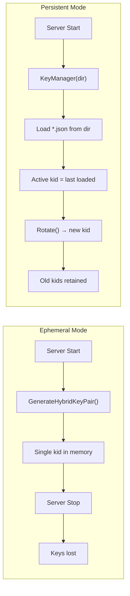
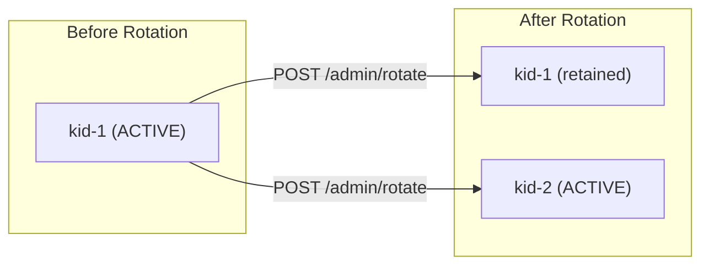

# Key Management & Rotation

DilithiAuth supports two key management modes: **ephemeral** (keys generated on startup, lost on restart) and **persistent** (keys saved to disk with rotation support).

## Modes Comparison



## Ephemeral Mode (Default)

When `DILITHIAUTH_KEYS_DIR` is not set, the server generates a single `HybridKeyPair` on startup.

- Keys exist only in memory
- Lost when the server restarts
- Tokens issued before a restart cannot be verified after restart
- Suitable for development and testing

```bash
# No keys dir configured — ephemeral mode
go run ./cmd/server
# Output: Hybrid key pair generated (ephemeral) – kid=abc123
```

## Persistent Mode (KeyManager)

When `DILITHIAUTH_KEYS_DIR` is set, the `KeyManager` persists keys as JSON files.

```bash
DILITHIAUTH_KEYS_DIR=./keys go run ./cmd/server
# Output: Key manager: persistent at ./keys – active kid=abc123
```

### How It Works

1. **Startup:** `KeyManager` scans the directory for `*.json` files
2. **Loading:** Each file is deserialized into a `HybridKeyPair`
3. **Initial key:** If no files exist, a new key pair is generated and saved
4. **Active key:** The last key loaded (most recently created) becomes active
5. **Signing:** All new tokens are signed with the active key
6. **Verification:** Any managed key can be used for verification (by `kid` lookup)

### Key File Format

Each key is stored as `<kid>.json`:

```json
{
  "kid": "abc123",
  "ed25519_public": "<base64>",
  "ed25519_private": "<base64>",
  "mldsa44_public": "<base64>",
  "mldsa44_private": "<base64>"
}
```

File permissions are set to `0600` (owner read/write only).

**Source:** `pkg/signer/keystore.go`

## Key Rotation



Rotation generates a new key pair, persists it, and makes it active. Old keys are **retained** for verifying tokens that were issued before rotation.

### Rotation Endpoint

```bash
curl -X POST http://localhost:8080/admin/rotate
```

```json
{
  "kid": "newKid456",
  "status": "rotated"
}
```

This endpoint is only available when `DILITHIAUTH_KEYS_DIR` is set.

### Rotation Behavior

| Aspect | Detail |
|--------|--------|
| New tokens | Signed with the new active key |
| Existing tokens | Still verifiable using their `kid` |
| JWKS endpoint | Serves **all** managed keys |
| File system | New `<kid>.json` file created |
| Thread safety | `sync.RWMutex` protects key list |

**Source:** `pkg/signer/keymanager.go`

## JWKS and Multiple Keys

When using `KeyManager`, the JWKS endpoint (`/.well-known/jwks.json`) returns all managed keys:

```json
{
  "keys": [
    {
      "kid": "oldKid123",
      "kty": "OKP",
      "crv": "Ed25519",
      "x": "...",
      "mldsa44_pub": "...",
      "use": "sig",
      "alg": "EdDSA+MLDSA44"
    },
    {
      "kid": "newKid456",
      "kty": "OKP",
      "crv": "Ed25519",
      "x": "...",
      "mldsa44_pub": "...",
      "use": "sig",
      "alg": "EdDSA+MLDSA44"
    }
  ]
}
```

This allows clients to verify tokens signed by any key that was ever active, even after rotation.

## Configuration

| Env Var | Default | Description |
|---------|---------|-------------|
| `DILITHIAUTH_KEYS_DIR` | *(empty — ephemeral)* | Directory for persistent key storage |
