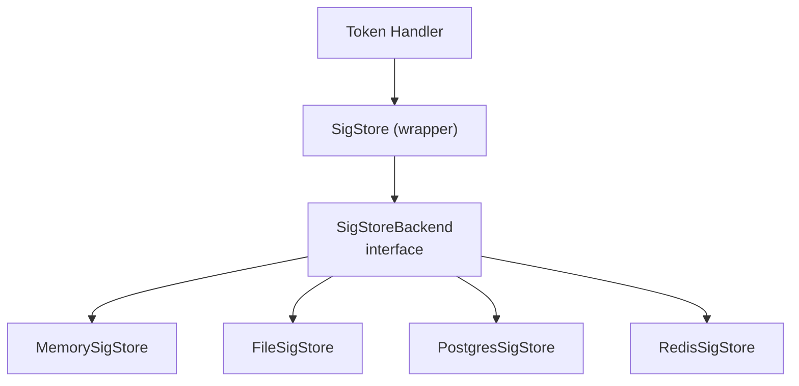
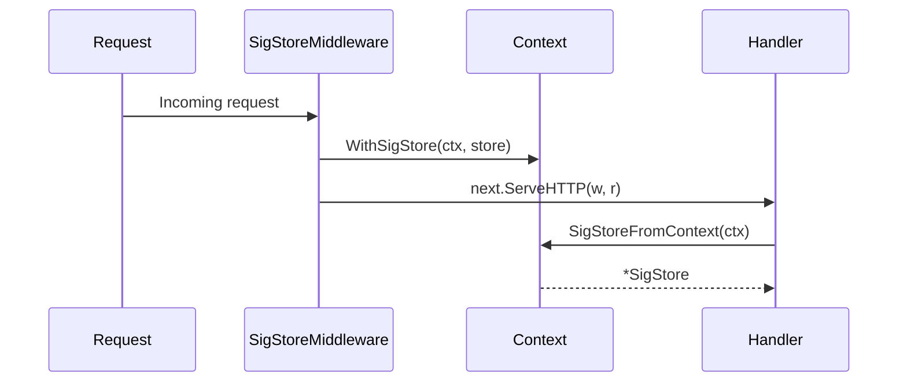

# Signature Store Backends

The **SigStore** is the sidecar that stores ML-DSA-44 signatures for thin JWTs and CWTs. It decouples signature storage from token issuance, allowing different backends depending on deployment requirements.

## Architecture



## SigStoreBackend Interface

All backends implement this four-method interface:

```go
type SigStoreBackend interface {
    Put(jti string, sig []byte)     // Store a signature
    Get(jti string) ([]byte, bool)  // Retrieve; (nil, false) on miss
    Delete(jti string)              // Remove a signature
    Len() int                       // Count stored entries
}
```

**Source:** `pkg/transport/middleware.go`

## Context Injection

The `SigStore` is injected into every request via middleware, so handlers don't need a direct reference.



**Usage in handlers:**
```go
store := transport.SigStoreFromContext(r.Context())
store.Put(jti, pqcSig)
sig, ok := store.Get(jti)
```

## Backend Implementations

### Memory (`MemorySigStore`)

Thread-safe in-memory map using `sync.RWMutex`.

- **Persistence:** None — data lost on restart
- **Scaling:** Single-node only
- **Latency:** Fastest (nanoseconds)
- **Use case:** Development, testing, single-instance demos

**Source:** `pkg/transport/memory_store.go`

```bash
DILITHIAUTH_SIGSTORE=memory  # default
```

### File (`FileSigStore`)

JSON file on disk with in-memory cache. Writes are atomic (temp file + `os.Rename`).

- **Persistence:** Durable to disk
- **Scaling:** Single-node only
- **Latency:** Fast reads (in-memory), slower writes (disk I/O)
- **Use case:** Single-instance with persistence across restarts

**Source:** `pkg/transport/file_store.go`

```bash
DILITHIAUTH_SIGSTORE=file
DILITHIAUTH_SIGSTORE_PATH=./data/sigstore.json  # default
```

### PostgreSQL (`PostgresSigStore`)

Stores signatures in a `sig_store` table, auto-created on startup.

- **Persistence:** Fully durable (PostgreSQL WAL)
- **Scaling:** Multi-instance (shared database)
- **Latency:** ~1-5ms per query
- **Use case:** Production multi-instance deployments

**Table schema:**
```sql
CREATE TABLE IF NOT EXISTS sig_store (
    jti        TEXT PRIMARY KEY,
    sig        BYTEA NOT NULL,
    created_at TIMESTAMPTZ DEFAULT NOW()
);
```

**Operations:**
- `Put` → `INSERT ... ON CONFLICT (jti) DO UPDATE SET sig = $2` (upsert)
- `Get` → `SELECT sig FROM sig_store WHERE jti = $1`
- `Delete` → `DELETE FROM sig_store WHERE jti = $1`
- `Len` → `SELECT COUNT(*) FROM sig_store`

**Source:** `pkg/transport/postgres_store.go`

```bash
DILITHIAUTH_SIGSTORE=postgres
DILITHIAUTH_POSTGRES_DSN=postgres://localhost:5432/dilithiauth?sslmode=disable
```

### Redis (`RedisSigStore`)

Stores signatures as Redis key-value pairs with configurable prefix and TTL.

- **Persistence:** Optional (Redis RDB/AOF)
- **Scaling:** Multi-instance (shared Redis)
- **Latency:** Sub-millisecond
- **Use case:** High-throughput production with automatic expiration

**Features:**
- Key prefix (default: `sigstore:`) for namespace isolation
- Optional TTL for automatic signature cleanup
- SCAN-based `Len()` to avoid blocking `KEYS` command

**Source:** `pkg/transport/redis_store.go`

```bash
DILITHIAUTH_SIGSTORE=redis
DILITHIAUTH_REDIS_ADDR=localhost:6379
```

**Programmatic options:**
```go
store, err := transport.NewRedisSigStore("localhost:6379",
    transport.WithKeyPrefix("myapp:sigs:"),
    transport.WithTTL(2 * time.Hour),
)
```

## Choosing a Backend

| Criteria | Memory | File | PostgreSQL | Redis |
|----------|--------|------|-----------|-------|
| Multi-instance | No | No | Yes | Yes |
| Persistence | No | Yes | Yes | Optional |
| Latency | ~ns | ~ms (writes) | ~1-5ms | ~sub-ms |
| Auto-expiry | No | No | No (manual) | Yes (TTL) |
| Setup complexity | None | None | PostgreSQL required | Redis required |
| Best for | Dev/test | Single-node prod | Durable multi-node | Fast multi-node |
