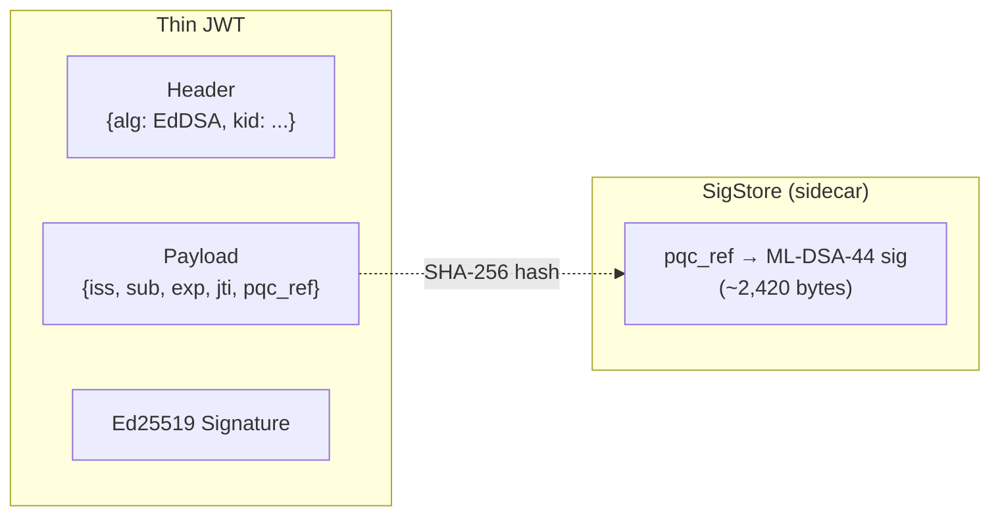
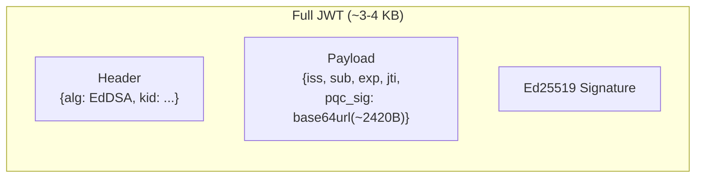
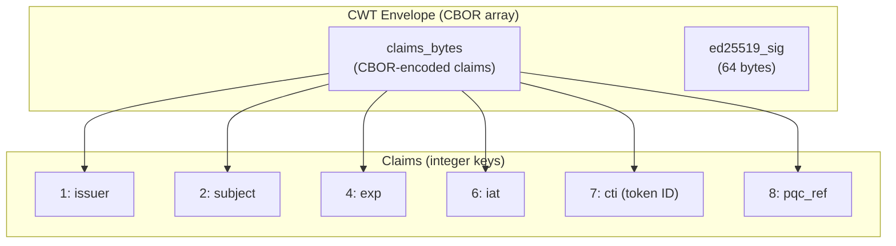

# Token Issuance Strategies

DilithiAuth supports three token formats, each with different trade-offs between token size, self-containment, and infrastructure requirements.

## Strategy Comparison

| Aspect | Thin JWT | Full/Jumbo JWT | CWT |
|--------|----------|----------------|-----|
| **Format** | JSON (JWT) | JSON (JWT) | Binary (CBOR) |
| **Token Size** | ~500 bytes | ~3-4 KB | ~200-300 bytes |
| **Self-Contained** | No | Yes | No |
| **Sidecar Required** | Yes | No | Yes |
| **Ed25519 Sig** | JWT signature | JWT signature | CBOR envelope |
| **ML-DSA-44 Sig** | SigStore (via `pqc_ref`) | Embedded (`pqc_sig`) | SigStore (via `pqc_ref`) |
| **16 KiB Headers** | Not needed | Required | Not needed |
| **Best For** | High-traffic APIs | Offline/stateless verification | Bandwidth-constrained (IoT) |

## 1. Thin JWT (Signature Reference)

The thin JWT keeps the token small by storing the ML-DSA-44 signature in a sidecar store (SigStore) and embedding only a SHA-256 hash reference (`pqc_ref`) in the token.



**Issuance:** `POST /token/thin?sub=alice`

```bash
curl -X POST "http://localhost:8080/token/thin?sub=alice"
```

```json
{
  "access_token": "eyJhbGciOiJFZERTQSIsImtpZCI6Ii4uLiJ9...",
  "token_type": "Bearer",
  "pqc_ref": "abc123..."
}
```

**How it works:**
1. Marshal registered claims to JSON
2. Sign payload with both Ed25519 and ML-DSA-44
3. Compute `pqc_ref = base64url(SHA-256(mldsa_sig))`
4. Embed `pqc_ref` in JWT claims
5. Sign JWT with Ed25519 via `jwt-go`
6. Return JWT + ML-DSA-44 signature separately for SigStore storage

**Source:** `pkg/oauth/oauth.go` — `IssueJWTThin()`

## 2. Full/Jumbo JWT (Self-Contained)

The full JWT embeds the entire ML-DSA-44 signature directly in the `pqc_sig` claim, making the token self-contained but large.



**Issuance:** `POST /token/full?sub=alice`

```bash
curl -X POST "http://localhost:8080/token/full?sub=alice"
```

```json
{
  "access_token": "eyJhbGciOiJFZERTQSIsImtpZCI6Ii4uLiJ9...<long>...",
  "token_type": "Bearer"
}
```

**How it works:**
1. Marshal registered claims to JSON
2. Sign payload with both Ed25519 and ML-DSA-44
3. Embed `pqc_sig = base64url(mldsa_sig)` directly in JWT claims
4. Sign JWT with Ed25519 via `jwt-go`
5. No sidecar needed — token is fully self-contained

**Trade-off:** Requires the server and all proxies (Nginx, load balancers) to accept headers up to 16 KiB.

**Source:** `pkg/oauth/oauth.go` — `IssueJWTFull()`

## 3. CWT — CBOR Web Token (RFC 8392)

CWTs use binary CBOR encoding with integer claim keys, producing the smallest tokens. Like thin JWTs, they use the sidecar strategy for ML-DSA-44 signatures.



**Issuance:** `POST /token/cwt?sub=alice`

```bash
curl -X POST "http://localhost:8080/token/cwt?sub=alice" \
  --output token.cbor
```

Response headers:
- `Content-Type: application/cbor`
- `X-Token-Id: <jti>`
- `X-PQC-Ref: <pqc_ref>`

**How it works:**
1. Build `CWTClaims` with integer keys (RFC 8392)
2. CBOR-encode base claims (without `pqc_ref`)
3. Sign encoded bytes with both Ed25519 and ML-DSA-44
4. Compute `pqc_ref` and add it to claims
5. Re-encode claims with `pqc_ref`
6. Create CBOR envelope: `[claims_bytes, ed25519_sig]`
7. ML-DSA-44 signature stored in SigStore keyed by `cti`

**Source:** `pkg/oauth/oauth.go` — `IssueCWT()`

## Choosing a Strategy

| Scenario | Recommended |
|----------|------------|
| API gateway with shared cache (Redis/Postgres) | **Thin JWT** |
| Offline token validation, no shared state | **Full JWT** |
| IoT devices, constrained bandwidth | **CWT** |
| Standard web application | **Thin JWT** |
| Regulatory requirement for self-contained proof | **Full JWT** |
