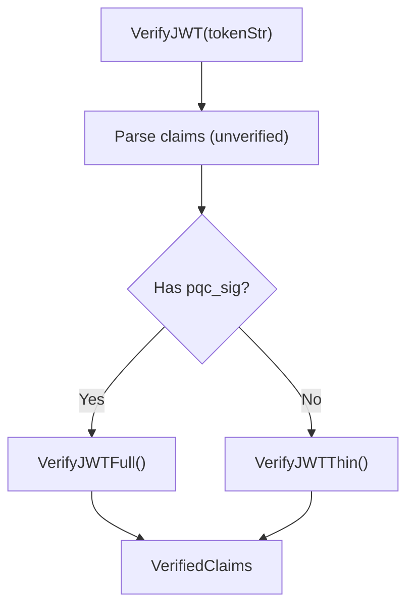
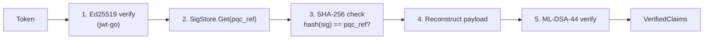
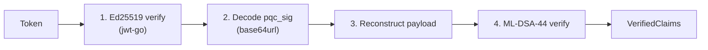
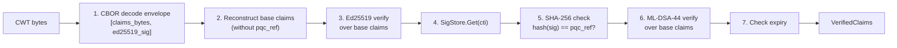
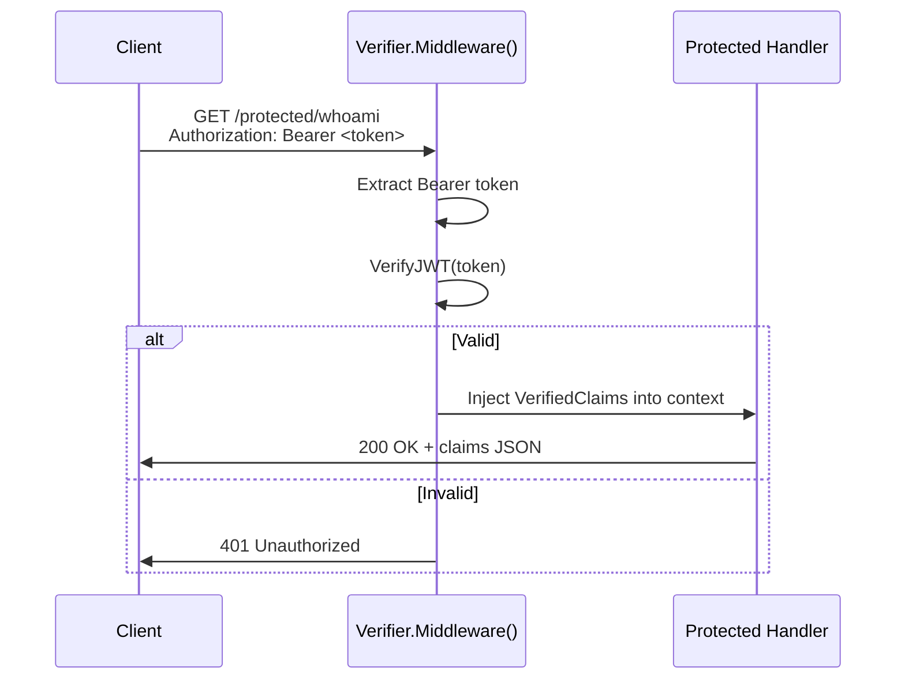

# Token Verification

The `pkg/verifier` package handles verification of all three token formats (thin JWT, full JWT, CWT) with automatic format detection and HTTP middleware for protecting endpoints.

## Verifier Setup

The `Verifier` holds references to key material and the SigStore:

```go
// With KeyManager (supports rotation)
v := verifier.NewVerifier(km, sigStore)

// With single key pair (no rotation)
v := verifier.NewVerifierWithKeyPair(kp, sigStore)
```

## Auto-Detection Flow

`VerifyJWT()` automatically detects whether a JWT is thin or full by peeking at the claims.



**Source:** `pkg/verifier/verifier.go`

## Thin JWT Verification



**Steps:**

1. **Ed25519 verification** — `jwt-go` parses and verifies the JWT signature using the Ed25519 public key resolved by `kid`
2. **SigStore lookup** — Retrieve the ML-DSA-44 signature using the `pqc_ref` claim as the key
3. **Hash check** — Verify that `base64url(SHA-256(retrieved_sig))` matches the `pqc_ref` in the token
4. **Payload reconstruction** — Marshal `RegisteredClaims` to JSON (same format used during signing)
5. **ML-DSA-44 verification** — Verify the ML-DSA-44 signature over the reconstructed payload

## Full JWT Verification



**Steps:**

1. **Ed25519 verification** — Same as thin
2. **Decode embedded signature** — Base64url-decode the `pqc_sig` claim to get raw ML-DSA-44 signature bytes
3. **Payload reconstruction** — Marshal `RegisteredClaims` to JSON
4. **ML-DSA-44 verification** — Verify the signature over the reconstructed payload

No SigStore lookup needed — the token is self-contained.

## CWT Verification



**Steps:**

1. **CBOR decode** — Unmarshal the envelope `[claims_bytes, ed25519_sig]`
2. **Reconstruct base claims** — Build `CWTClaims` without `pqc_ref` (this is what was originally signed)
3. **Ed25519 verification** — Verify Ed25519 signature over the base claims bytes
4. **SigStore lookup** — Retrieve ML-DSA-44 signature using `JWTID` (claim key `7`)
5. **Hash check** — Verify `pqc_ref` matches `SHA-256(sig)`
6. **ML-DSA-44 verification** — Verify over the same base claims bytes
7. **Expiry check** — Ensure `exp` has not passed

## VerifiedClaims

All verification methods return the same struct:

```go
type VerifiedClaims struct {
    Issuer    string    `json:"iss"`
    Subject   string    `json:"sub"`
    ExpiresAt time.Time `json:"exp"`
    IssuedAt  time.Time `json:"iat"`
    TokenID   string    `json:"jti"`
}
```

## HTTP Middleware

The `Middleware()` method returns chi-compatible middleware that protects endpoints:



**Usage:**

```go
r.Group(func(r chi.Router) {
    r.Use(v.Middleware())
    r.Get("/protected/whoami", func(w http.ResponseWriter, r *http.Request) {
        claims := verifier.ClaimsFromContext(r.Context())
        json.NewEncoder(w).Encode(claims)
    })
})
```

**Source:** `pkg/verifier/middleware.go`

## Key Resolution

The verifier resolves keys by `kid` from the JWT header:

- **With `KeyManager`:** Calls `km.KeyByKid(kid)` — supports multiple rotated keys
- **With single `KeyPair`:** Checks if `kp.Kid == kid` — only the one key
- **CWT verification:** Uses `activeKeyPair()` (CWTs don't carry a `kid` header)
