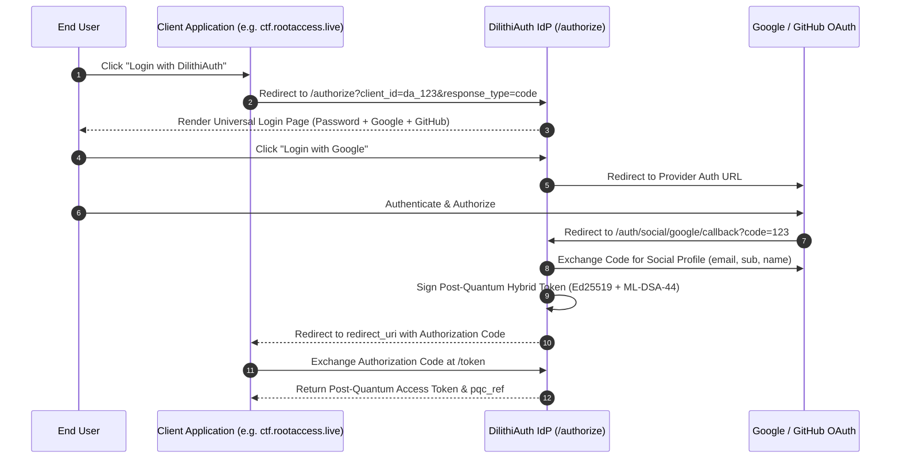

# DilithiAuth Social Login Integration Guide

This guide explains how **Social Authentication (Google & GitHub)** and **Multi-Factor Authentication (TOTP 2FA)** work in **DilithiAuth**, and how to configure them for production.

---

## 🔑 Overview

DilithiAuth provides two authentication modes on its **Hosted Universal Login Page** (`/authorize`):

1. **Standard Password + TOTP 2FA Authentication**: Works 100% out-of-the-box with **zero external dependencies**.
2. **Social Identity Federation (Google & GitHub)**: Delegates identity verification to Google or GitHub, and issues a **Post-Quantum Hybrid Token (Ed25519 + ML-DSA-44)** back to client applications.

---

## ⚙️ Environment Variables Configuration

To enable Social Login, set the following environment variables on the `dilithiauth-server` binary or deployment container:

```bash
# Google OAuth 2.0 Credentials
DILITHIAUTH_GOOGLE_CLIENT_ID="your-google-client-id.apps.googleusercontent.com"
DILITHIAUTH_GOOGLE_CLIENT_SECRET="your-google-client-secret"

# GitHub OAuth 2.0 Credentials
DILITHIAUTH_GITHUB_CLIENT_ID="your-github-client-id"
DILITHIAUTH_GITHUB_CLIENT_SECRET="your-github-client-secret"
```

---

## 🛠️ Step-by-Step Setup Guide

### 1. Google OAuth 2.0 Setup

1. Navigate to [Google Cloud Console](https://console.cloud.google.com/) → **APIs & Services** → **Credentials**.
2. Click **Create Credentials** → **OAuth client ID**.
3. Select Application type: **Web application**.
4. Set **Name**: `DilithiAuth Production`.
5. Set **Authorized redirect URIs**:
   ```text
   https://dilithiauthapis.gradientgeeks.tech/auth/social/google/callback
   ```
   *(For local dev, add `http://localhost:8080/auth/social/google/callback`)*
6. Copy the generated **Client ID** and **Client Secret**.

---

### 2. GitHub OAuth Setup

1. Navigate to [GitHub Settings → Developer Settings → OAuth Apps](https://github.com/settings/developers).
2. Click **Register a new application**.
3. Set **Application name**: `DilithiAuth`.
4. Set **Homepage URL**: `https://dilithiauthapis.gradientgeeks.tech`.
5. Set **Authorization callback URL**:
   ```text
   https://dilithiauthapis.gradientgeeks.tech/auth/social/github/callback
   ```
   *(For local dev, add `http://localhost:8080/auth/social/github/callback`)*
6. Click **Register application**, then generate a **Client Secret**.
7. Copy the **Client ID** and **Client Secret**.

---

## 🛡️ Fallback Behavior (Unconfigured Keys)

If environment variables are omitted or empty:
- Username/Password authentication and **TOTP MFA (Google Authenticator / Authy)** remain active.
- If an end-user clicks the Google or GitHub button on `/authorize`, the system safely displays:
  > *"Social login provider has not been configured by the server administrator yet."*

---

## 🔄 End-to-End OAuth 2.0 Flow


